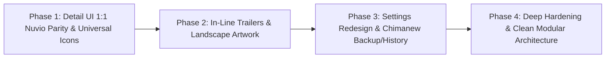

# OmniTrack Master Roadmap & Engineering Specification

> **Target Platform:** Samsung Galaxy S24 Ultra (Android 17, One UI 9, 120Hz Pure AMOLED `#000000`)  
> **Architectural Standard:** Chimanew/Mihon Clean Architecture + Nuvio 1:1 Visual Parity  
> **Status:** Active Execution Tracker  

---

## 📜 User Directives & Verbatim Architecture Specification

The following directives are transcribed directly from Exile's requirements and serve as the binding contract for all OmniTrack implementation:

### 1. Detail UI, Ratings, Comments, Networks & Artwork (Verbatim)
> "ratings in detail page must have 1 to 1 same ui as nuvio, right now they are pills  
> i dont want pills, like it says STUDIO, but its a pill, status too  
> also make it the same size as in nuvio, its smaller right now, everything u ported  
> comments have bad formatting, for example i can see ** asterisks and other formatting issues  
> make the ui 1 to 1 nuvio  
> make the "REVIEW" green icon to how it looks in nuvio 1 to 1, even when i open it, see spoiler, etc  
> also in nuvio, for the same show i see 33 trakt comments compared to 3 in omnitrack, fix it, see how nuvio does it  
> its not even cinematically transparent and blurred like in nuvio  
> there is no Networks section  
> clicking ast and characters should open the same page it opens in nuvio, one to one same everything, ui  
> where it says EP count, its too crowded that button, remove the +1 and maybe the pencil icon? show me ui examples when we are at this phase, i want what looks best  
> u did not port "Show Details" from nuvio correcty, ours has less info and squared, copy nuvio ui  
> more like this size should also increase, idk if in nuvio these posters also follow our posters settings size or not, what about porting tmdb enrichment and mdblist ratings from nuvio? if our already works, then still see how nuvio does it to confirm we did correctly  
> nuvio also has simkl, but i already showed u better integration from nuvio enhanced app https://github.com/ExZyO/NuvioMobile-Enhanced  
> clicking networks should also open what it does in nuvio, exact same ui  
> in nuvio when u open trailers, it doesnt open in yt or external sources, nuvio has its own ui, port that  
> in nuvio, when i switch to landscape covers, nuvio shows different covers than when portrait, do that in omnitrack also, port it but also let me select manually art alongside how we do cover and banner currently  
> list all the art sources, external sources the app uses, where, how to test it, we will test one by one and fix them  
> backup, it backs up everything, i want to be able to select what to backup like in chimanew C:\Users\M7 Surface\Documents\Chimanew  
> add filters and other functions to history tab, port relevant ones from chimanew, ask me also  
> verify discover tab ai button works, i dont think it does  
> maybe add a Home tab like in chimanew? port it, we will decide later"

### 2. Chimanew Systems Architect Engineering Contract (Verbatim)
> "You are a Senior Android and Kotlin Multiplatform Systems Architect specializing in large, multi-module media and reader ecosystems (Mihon, Tachiyomi, Komikku, and Chimahon architectures).  
> 
> Your task is to analyze, design, and implement features with zero code duplication, strict architectural boundaries, and high-efficiency performance standards.  
> 
> When implementing or reviewing any feature, adhere strictly to the following engineering requirements:  
> 
> 1. Architectural Separation and Domain Purity  
> - Domain Layer (domain): Must contain only pure Kotlin business logic, domain models, and single-purpose interactors/use-cases. Never import Android framework classes, UI dependencies, or raw database drivers into domain modules.  
> - Data Layer (data): Owns SQLDelight/Room database queries, network repositories, and preferences stores. All database calls must be exposed to the domain layer via repository interfaces.  
> - Presentation Layer (presentation): Composable functions only. Must be stateless, driven by immutable UI state objects, and free of direct repository or database calls.  
> - Application/Feature Layer (app/ui): Voyager ScreenModels or Jetpack ViewModels orchestrating interactors, holding StateFlow streams, and injecting dependencies via Injekt or Koin.  
> 
> 2. Upstream Harmonization and Deduplication  
> - Parity Across Media Verticals: When a feature applies to multiple media types (Manga, Anime, Novels), unify the contract under shared abstractions (e.g., shared LibraryGroup tokens, unified Tracker managers, or synchronized global preference flows). Never copy-paste near-identical ScreenModels or Dialogs with renamed variables.  
> - Upstream Patch Compatibility: Keep custom fork logic decoupled from upstream core files. Isolate new functionality behind extension functions, interfaces, or dedicated service wrappers so future upstream merges do not cause conflict cascades.  
> 
> 3. Database and Query Optimization  
> - Eliminate N+1 Queries: Always batch lookups using indexed foreign keys (e.g., grouping tracks by mangaId in memory rather than querying per row in loops).  
> - Lightweight Summary Projections: When an operation only needs metadata (e.g., latest chapter number, unread counts), query targeted summary projections instead of hydrating full entity trees with thousands of chapter rows.  
> - Local State First: Read local database caches before making network requests. Network checks should only occur when explicitly requested, when cache validity has expired, or when a background scheduler triggers them.  
> 
> 4. Network, Tracker, and Pipeline Resilience  
> - Source Scrapers vs. Trackers: Always distinguish content sources (extensions that host images or text) from metadata trackers (AniList, MyAnimeList, Kitsu, Bangumi). Trackers provide status signals; sources provide actual content.  
> - Plausibility Boundaries: Validate external tracker counts against local databases using plausibility checks (e.g., chapter count differences between 0.5 and 200) to reject web novel chapter mismatches from triggering false updates on manga.  
> - Rate Limiting and Concurrency: Guard external API queries with single-permit Semaphores and pacing delays. Never blast rate-limited tracker endpoints in parallel.  
> - Resilient Bypass and Fast-Skip: Detect Cloudflare or CAPTCHA blocks immediately. Log the challenge, skip the blocked host to prevent queue hangs, and surface direct user verification intents rather than retrying indefinitely.  
> - Native Lossless Media: Default to uncompressed original asset URLs. Strip preview and thumbnail downscaling suffixes (.512.jpg, .256.jpg, /large/) when persisting cover art.  
> 
> 5. Implementation Delivery Format  
> When asked to implement any feature, structure your response as follows:  
> - Architecture and Flow Analysis: High-level overview of affected layers and data flow.  
> - Domain Models and Interactors: Interface definitions, data contracts, and use cases.  
> - Repository and Database Implementations: Query modifications, batch operations, and caching rules.  
> - ScreenModel and UI Presentation: StateFlow state definitions, event handlers, and Jetpack Compose composables.  
> - Verification and Regression Checklist: Specific test scenarios, edge cases (e.g., offline mode, empty libraries, Cloudflare challenges), and performance checks."

### 3. Poster Card Style, Card Depth, Title Logos & Books Directives (Verbatim)
> "nuvio has custom poster source in poster card style settings, port all of that too  
> what does always backdrop with logo for landscape posters do?  
> i also want the exxact way nuvio card depth effect settings work, ui, etc, basically port all of poster card style setting, nuvio has, like, title logos in posters, i want that too. oh but is all this complicated or not possible for everything because nuvio has tv shows, anime, movies only meanwhile our app has everything?  
> OH are we missing books category? what else, would have to add that too from the best sources for it /grill-me  
> i noticed in roadmap.md it says Upgrade Gemini model endpoint to gemini-2.5-flash  
> not 2.5, make it gemini-3.8-flash  
> also, i realized even horizontal posters in nuvio has that title logo, update that  
> track book my chapter too if possible  
> EP Counter option A  
> 2. add always backdrop with logo for landscape setting too where it applies  
> 3. yes lets use what u said is the gold standard for books stuff, metadata, tracking, etc"

### 4. Direct Logins vs. Fallback API Keys (Verbatim)
> "also add to roadmap that i dont want the fallback api keys for trackers that support direct login, so remove that ui and functionality from the app and i only want logins, unless the tracker or service only supports api key from the USER  
>   
> if i as a dev need to add a client or some other key to the app, thats fine too. i know many devs do that"

### 5. Hero Trailer Player, 7s Stationary Debounce & 1:1 Tracker Scores (Verbatim)
> "also, Port Nuvio's HeroTrailerPlayerSurface with ExoPlayer  
> whatever nuvio uses, exactly that  
> Require 7.0 seconds of continuous screen stillness before auto-playing on screen open or re-scroll. or whatever is the standard  
> anilist, mal, etc tracker scores show up wrong, do it exactly like nuvio and nuvio enhanced does it so it works properly"

---

## 🛡️ Architectural Traps & Quality Guardrails

The following 7 technical guardrails are binding constraints across all implementation phases:

1. **Guardrail 1: Step 0 Core Reactivity & OAuth Verification**
   - Live Room reactivity: `_mediaId.flatMapLatest { repository.getMediaById(it) }` in `DetailViewModel.kt`.
   - Global `PreferenceManager` API key wiring for TMDb, Fanart.tv, MDBList, and Steam CDN fallbacks (`library_600x900_2x.jpg` -> `library_600x900.jpg` -> `capsule_imagev5` -> `header_image`).
   - OAuth redirects: SIMKL (`nuvio://auth/simkl` + PIN), Comick (`S256 PKCE`), Bangumi (`https://next.bgm.tv/demo/access-token/create`), Trakt device flow (`trakt.tv/activate`), and Steam vanity resolution.
2. **Guardrail 2: Landscape Mode & Clearart Projections (`MediaCardSummary`)**
   - Add `clearartUrl` to `MediaCardSummary.kt` and `MediaDao.getAllMediaSummaries()` so 16:9 cards never crash or render blank in landscape library grids.
3. **Guardrail 3: In-Line YouTube Trailer Player**
   - Use embedded YouTube IFrame / innerTube stream extractor inside `TrailerPlayerPopup` and `HeroTrailerPlayerSurface`—never pass raw `youtube.com/watch` into ExoPlayer `MediaItem.fromUri()`.
4. **Guardrail 4: Multi-Vertical Network & Cast Browsing with Ephemeral Preview**
   - Support both TMDb (movies/shows) and AniList GraphQL (anime studios e.g. MAPPA/Ufotable, staff, voice actors).
   - Tapping items in `PersonDetailScreen`, `NetworkBrowseScreen`, or `More Like This` MUST open in **Ephemeral Preview Mode** (never auto-inserting into Room).
5. **Guardrail 5: Exhaustive `when (mediaType)` Handling for `BOOK`**
   - Update every `when (mediaType)` across the entire app (`OmniSearchRepository`, `ArtworkWaterfallRepository`, `DetailScreen`, `ArtworkPriorityScreen`, `MultiTrackerSheet`, `TrackerSyncEngine`).
   - Support dual tracking units: **Pages (`Page 142 / 688`)** and **Chapters (`Ch 12 / 34`)** with a toggle.
   - Wire Google Books (`zoom=0`), Open Library, and Hardcover GraphQL.
6. **Guardrail 6: Non-Destructive Granular Backup Restore**
   - `BackupOptions` checkboxes in Phase 3.2 must ONLY wipe/replace the specific Room tables, DataStore keys, or custom artwork folders whose checkbox is actually checked.
7. **Guardrail 7: Direct Login Only for OAuth-Supported Trackers**
   - Completely remove manual text API key input boxes from SIMKL, MAL, AniList, Bangumi, Trakt, and Comick.
   - Keep API key input fields strictly for services requiring user keys (Steam Web API, VNDB token, TMDb, Fanart.tv, MDBList, Gemini, OpenRouter).

---

## 🧭 Master Phasing Overview

---

## 📌 Phase 1: Detail Screen 1:1 Nuvio Parity & Universal Brand Icons

### 1.1 Unboxed Detail Metadata & Ratings Row (Zero-Pill Architecture)
- [x] **Eliminate Pill Boxes on Metadata**: Removed rounded pills from `STUDIO`, `STATUS`, `RUNTIME`, and `AGE`.
  - Replicate Nuvio `DetailMetaInfo.kt` exact typography:
    - Release & Genre Line: `2024 • Action, Sci-Fi` in `FontWeight.Bold`, 15sp.
    - Runtime: `2h 15m` in `FontWeight.Bold`, 15sp.
    - Age Certification: Subtle hairline square border (`PG-13`, `TV-MA`).
- [x] **1:1 Nuvio Ratings Row (`NuvioRatingsRow.kt`)**:
  - Horizontal scroll with `spacedBy(14.dp)`.
  - Official brand logos from `NuvioMobile-Enhanced` and `Chimanew` (`rating_imdb.png`, `rating_rotten_tomatoes.png`, `rating_rotten_tomatoes_certified.png`, `rating_metacritic.png`, `rating_tmdb.png`, `rating_trakt.png`, `rating_letterboxd.png`, `rating_mal.png`, `brand_anilist.xml`, `brand_steam.xml`, `brand_vndb.xml`).
  - Sizing matching Nuvio: Height 16dp (RT certified 24dp), width 30dp for IMDb, bold value next to logo spaced by 4dp. Zero pills, zero emojis.
- [x] **Universal Icon Upgrade**:
  - Migrated 28 high-res assets to `app/src/main/res/drawable/`.

### 1.2 Community Reviews & Trakt Comments (1:1 Nuvio Experience)
- [x] **Pagination to 100 Comments**: Replace 3-item limit with Trakt pagination `https://api.trakt.tv/shows|movies/{id}/comments/likes?page=1&limit=100`.
- [x] **Resolve Trakt Slug by TMDb ID**: Query `https://api.trakt.tv/search/tmdb/{id}?type={movie|show}` with Trakt Client ID `eyAYRNGOL9TopY6lw3agFsTWDZVfiqMG3tp0DMBQo2U` so that every title finds its full Trakt discussion thread (33+ comments).
- [x] **Clean Markdown & BBCode Stripping**:
  - Strip bold `**`, italics `*`, headers `#`, and BBCode `[spoiler]...[/spoiler]` via `sanitizeCommunityComment()`.
  - Render spoiler warning cards: `Contains spoilers • Tap to read` in warning amber.
- [x] **1:1 Nuvio Review Card Styling**:
  - Card dimensions: `width = 280.dp`, `height = 190.dp`, corner radius 16dp.
  - Surface color: `Color(0xFF121212)` with AMOLED translucent depth.
  - Official green stadium pill chip: `REVIEW` (`#1B3D2F` background, `#00E054` text) when `isReview == true`.
- [x] **Interactive Comment Detail Sheet**:
  - Full-screen / modal sheet (`CommentDetailSheet.kt`) with spoiler reveal toggle and bilateral previous/next navigation buttons (`1 / 33`).

### 1.3 Networks & Production Section
- [x] **Add Dedicated Networks / Production Companies Section (`DetailNetworksSection.kt`)**:
  - Display horizontal flow chips with network logo (Netflix, HBO, AMC, Crunchyroll, etc.) or studio logo (MAPPA, Ufotable, Warner Bros).
  - Chip height: 36dp, corner radius 12dp, light `#EFEFEF` background.
- [x] **Clickable Network / Studio Browser (`TmdbEntityBrowseScreen.kt`)**:
  - Tapping a network or company opens `TmdbEntityBrowseScreen` showing their catalog filmography in poster rails with Ephemeral Preview Mode.

### 1.4 Cast & Characters with Full Person Detail Page
- [x] **Cast Section Sizing & Styling**:
  - Circular avatar (56dp), actor name in bold (13sp), character name in muted (11.5sp).
- [x] **Interactive Person Detail Page (`PersonDetailScreen.kt`)**:
  - Tapping any actor or character opens `PersonDetailScreen`:
    - Actor profile photo & biography (expandable).
    - Known For / Movies / TV Shows horizontal poster rails using `NuvioRailPosterCard(135.dp, 202.dp)`.
    - Tapping filmography items opens their Detail screen in Ephemeral Preview Mode.

### 1.5 Show & Production Details Section Redesign
- [x] **Replace Boxed Show Details (`DetailShowDetailsSection.kt`)**: Eliminated the heavy rectangular card.
- [x] **Clean Unboxed Vertical List**:
  - Left: Label (`Status`, `Release Date`, `Runtime`, `Certification`, `Production`) in semi-bold `onSurface.copy(alpha = 0.8f)`.
  - Right: Value aligned right.
  - Hairline dividers between rows (`0.10f alpha`).

### 1.6 Progress & EP Counter Row Refinement
- [x] **EP Button Option A (Selected by Exile)**:
  - Clean Minimalist Counter: Large, bold number (`12 / 24` or `14.5 hrs`) with uppercase label (`EPISODES`, `HOURS`, `PAGES`, `CHAPTERS`) in cyan.
  - 100% uncluttered: eliminated both the pencil icon in a circle and the crowded `+1` button badge.
  - Entire number block is a clean, spacious touch target that opens the smooth jog-dial stepper / slider sheet on tap.

### 1.7 "More Like This" & Franchise Relations
- [x] **Enlarge Posters**: Match Nuvio's rail poster dimensions (`135.dp × 202.dp`) via unified `NuvioRailPosterCard.kt`.
- [x] **Maintain Ephemeral Preview Mode**: Never auto-insert into Room database upon browsing.

### 1.8 Books Vertical (Google Books & Open Library Gold Standard)
- [x] **Dedicated `Books` Category (`MediaType.BOOK`)**:
  - Separate standard published literature/books from Light Novels / Web Novels (`MediaType.NOVEL`).
  - Dual Tracking Units: Supports tracking by **Pages** (`Page 142 / 688`) and by **Chapters** (`Ch 12 / 34`).
  - Primary API: Google Books API (lossless `zoom=0` 1000px+ covers, ISBN-10/13, page count, author, publisher, publication date, synopsis).
  - Secondary API: Open Library (Internet Archive) cover archive & edition resolver.
  - Fully integrated in `OmniSearchRepository.kt`, `ArtworkWaterfallRepository.kt`, `PreferenceManager.kt`, and `ArtworkPriorityScreen.kt`.

---

## 📌 Phase 2: In-Line Hero Trailers, Accurate Tracker Scores & Landscape Artwork System

### 2.1 Hero Trailer Player & Debounce Controls (Exact Nuvio 1:1 Parity)
- [ ] **Port Nuvio's `HeroTrailerPlayerSurface` with ExoPlayer**:
  - Exact 1:1 port of Nuvio / Nuvio Enhanced implementation (`HeroTrailerPlayerSurface.android.kt` using `androidx.media3.exoplayer.ExoPlayer`).
  - Whatever Nuvio uses, exactly that: `TextureView` container with `MergingMediaSource` (separate progressive video stream + separate adaptive audio stream from InnerTube/YouTube cipher extractor), hardware-accelerated surface rendering, video-matrix aspect fill cropping, and zero external redirects.
- [ ] **7.0-Second Stationary Debounce Delay**:
  - Require **7.0 seconds** of continuous screen stillness before auto-playing on screen open or re-scroll (standard stationary debounce delay so user can read synopsis, examine metadata, and review ratings without premature video or audio disturbance).
  - Reset timer immediately upon any scroll delta or touch interaction.
- [ ] **Re-Scroll Resume Policy**:
  - Auto-pause instantly when scrolled out of viewport.
  - Require stationary debounce stillness (or explicit manual tap) to resume when scrolled back into view.
  - Mute/unmute toggle pill overlay (`HeroTrailerAudioState`).
- [ ] **Internal Trailer Popup (`TrailerPlayerPopup.kt`)**:
  - Tapping trailer button opens internal popup bottom sheet with embedded ExoPlayer surface, scrub bar, and fullscreen landscape lock—never redirects to external YouTube or browser app.

### 2.2 Accurate Tracker Scores Normalization (AniList, MAL, Bangumi 1:1 Nuvio Parity)
- [ ] **Fix Tracker Scores (AniList, MAL, Bangumi, Steam, VNDB)**:
  - AniList, MAL, etc. tracker scores show up wrong: Replicate exact rating computation, normalization, and display formatting from Nuvio and Nuvio Enhanced (`DetailMetaInfo.kt` / `NuvioRatingsRow.kt`).
  - **MyAnimeList (MAL)**: 10-point decimal scale formatted to 2 decimals or 1 decimal (e.g. `8.45` or `8.5`) with MAL brand blue (`#2E51A2`).
  - **AniList**: 100-point percentage scale (e.g. `84%`) normalized with `%` badge, or 10-point decimal, matching AniList user preferred format with brand cyan (`#02A9FF`).
  - **Bangumi**: 10-point decimal scale (e.g. `8.2`) with Bangumi brand pink (`#F09199`).
  - **Steam**: Positive review percentage (e.g. `94%`) with Steam brand blue (`#66C0F4`).
  - **VNDB**: 10-point decimal scale (e.g. `8.50`) with VNDB brand blue (`#2A5684`).
  - **TMDb / IMDb / Rotten Tomatoes / Metacritic / Trakt / Letterboxd**: Exact Nuvio `ratingVisuals` alignment: IMDb `formatOneDecimal` (`#F5C518`), TMDb `formatWhole` (`#01B4E4`), Rotten Tomatoes `formatPercent` (`#FA320A`), Metacritic `formatWhole` (`#FFCC33`), Trakt `formatWhole` (`#ED1C24`), Letterboxd `formatOneDecimal` (`#00E054`).

### 2.3 Landscape vs Portrait Cover Artwork Ecosystem & Nuvio Card Depth
- [ ] **Dynamic Landscape Card Mode (`catalogLandscapeModeEnabled`)**:
  - In library and browse grids, allow switching between Portrait (2:3) posters and Landscape (16:9) backdrop cards.
- [ ] **Always Backdrop with Logo for Landscape Posters (`alwaysShowLandscapeClearlogo`)**:
  - Setting in Poster Card Style: When enabled, forces the card to use the textless 16:9 photo (`bannerUrl`) and overlays the transparent title logo (`clearartUrl` / `logoUrl`) on the bottom-left, instead of landscape posters with pre-baked text.
- [ ] **Horizontal Posters Clearart Logo Overlay**:
  - Replicate Nuvio's exact clearart overlay on horizontal posters with subtle bottom scrim.
- [ ] **Nuvio Card Depth Effect (`nuvioCardDepth`)**:
  - 1dp top-to-bottom edge specular light gradient (`Brush.verticalGradient`).
  - Soft curved glass top-sheen reflection (`drawRect` gradient).
  - Configurable edge strength (subtle, balanced, bold), sheen strength (off, soft, bright), and coverage (top, half, full).
  - 2D interactive touch pad for real-time fine-tuning.
  - Surface selectors: Posters, Continue Watching, Episode Cards, Cast, Trailers.
- [ ] **Custom Poster Source Pattern (`CustomPosterUrlRepository`)**:
  - Allow entering a custom poster URL pattern template (e.g. `https://api.mycdn.com/posters/{id}.jpg` or RPDB) with per-screen toggles (Home, Library, Search, Details).
- [ ] **Granular Manual Artwork Picker**:
  - Allow selecting:
    1. Portrait Poster (`coverUrl`)
    2. Landscape Backdrop / Banner (`bannerUrl`)
    3. Transparent Clearart Logo (`clearartUrl`)
  - Multi-CDN candidate search with manual preview.

---

## 📌 Phase 3: Settings Redesign & Chimanew Backup / History Port

### 3.1 Multi-Page Settings Hierarchy (Nuvio Cleanliness)
- [ ] **Root Settings Screen**:
  - Sectioned grouped squircle cards with hairline borders over AMOLED `#000000`:
    - `Appearance & Posters` (Aspect ratio, landscape mode, detail backdrop blur)
    - `Trackers & Sync Accounts` (Direct Logins Only: SIMKL, MAL, AniList, Bangumi, Trakt, Comick; remove manual text fallback API key boxes)
    - `Hero Trailers & Playback` (Debounce delay, auto-play policy, audio)
    - `External APIs` (Strictly user-required API keys: Steam Web API, VNDB token, TMDb, Fanart.tv, MDBList, Gemini, OpenRouter)
    - `Data & Storage` (Cache management, granular backup & restore)
    - `About & Attributions` (Version, release checks)
- [ ] **Dedicated Subpages**:
  - Navigate cleanly into dedicated subpages rather than cluttering a single scroll.

### 3.2 Granular Backup & Restore (Chimanew Port)
- [ ] **Selectable Backup Options (`BackupOptions`)**:
  - Checkboxes for what to export/import:
    - [x] Library Entries (Manga, Anime, Shows, Movies, Games, Novels, Books)
    - [x] Categories & Custom Groupings
    - [x] Progress & Chapter/Page History
    - [x] Tracker Logins & Tokens (`privateSettings`)
    - [x] Custom Covers & Custom Banners
    - [x] App Settings & Visual Preferences
- [ ] **Zero-Data Loss JSON/Proto Export**:
  - Encrypted, verified backup archive creation and restore file validator.

### 3.3 History Tab Filters & Search (Chimanew Port)
- [ ] **History Filters**:
  - Filter by Media Type (Anime, Manga, Shows, Movies, Games, Novels, Books).
  - Date grouping (Today, Yesterday, Last 7 Days, Older).
  - Clear history with confirmation dialog (all history or per-item).

### 3.4 Discover Tab AI Button Verification & Fix
- [ ] **Fix Discover AI Button**:
  - Surface active feedback banner when AI mode is enabled.
  - If no API key is configured, show a gentle toast/dialog linking directly to `Settings -> External APIs` to enter a Gemini or OpenRouter key.
  - Upgrade Gemini model endpoint to **`gemini-3.8-flash`**.

### 3.5 Home Tab Evaluation
- [ ] **Netflix-Style Hero Carousel**:
  - Prototype a dynamic Home tab featuring a top hero banner with trending/continue-watching items, silk dissolve transitions, and horizontal category shelves.

---

## 📌 Phase 4: Combined Deep Hardening & Clean Modular Architecture (Chimanew Architectural Contract)

### 4.1 Upstream Architectural Principles (Chimanew Architecture Contract)
- [ ] **Domain Purity**:
  - Pure Kotlin business logic in domain layer, completely decoupled from Android framework classes or SQLite drivers.
- [ ] **Eliminate N+1 Queries**:
  - Batch lookups using indexed foreign keys (grouping tracks in memory rather than querying per row in loops).
  - Lightweight summary projections (`MediaCardSummary`) instead of hydrating massive entity trees for simple grid views.
- [ ] **Network & Singleton Unification**:
  - Consolidate all network calls to a single shared `OkHttpClient` singleton with HTTP connection pooling, TLS session reuse, and rate-limiting semaphores (`NetworkPacer`).
  - Single `ImageLoader` configuration with memory cache tuning for 120Hz AMOLED screens.
- [ ] **Cloudflare Fast-Skip & Resilient Bypass**:
  - Detect Cloudflare CAPTCHAs immediately, log challenges, skip blocked hosts to prevent queue hangs, and surface direct user verification.
- [ ] **Native Lossless Media Pipeline**:
  - Strip downscaling suffixes (`.512.jpg`, `/large/`) to persist original high-res assets offline.
- [ ] **Plausibility Anomaly Window**:
  - Validate tracker counts against local databases using plausibility boundary checks to prevent mismatches.
- [ ] **Clean Feature Packaging**:
  - Refactor packages into clean boundaries:
    - `core:ui` (Design system tokens, Squircles, Glass borders, Rating chips)
    - `core:database` (Room DAO, migrations, entities)
    - `core:network` (Shared client, pacer, SSL)
    - `feature:detail` (Detail screen, sheets, cast, trailers)
    - `feature:settings` (Multi-page settings, backup, accounts)
    - `feature:tracking` (OAuth, sync engines, verifiers)

---

## 🔍 External Artwork & API Testing Matrix

| API / Provider | Verticals Supported | Endpoints Used | How to Test & Verify |
| :--- | :--- | :--- | :--- |
| **AniList** | Anime, Manga, Novels | GraphQL `https://graphql.anilist.co` | Search title in Discover or Artwork Picker; verify cover & banner URLs return 200 OK |
| **MangaDex** | Manga, Manhwa | REST `https://api.mangadex.org/` | Artwork Picker -> Manga vertical; check high-res volume covers load |
| **Bangumi** | Anime, Manga, Games, VNs | REST `https://api.bgm.tv/` | Search anime/game in Artwork Picker; verify Bangumi cover returns |
| **Kitsu** | Anime, Manga | REST `https://kitsu.io/api/edge/` | Fallback search in Artwork Picker; verify lossless cover string |
| **Comick** | Manga, Webtoons | REST `https://api.comick.fun/` | Authenticate in Accounts Sheet -> Test search & chapter sync |
| **TMDb** | Movies, TV Shows | REST `https://api.themoviedb.org/3/` | Check TMDb posters/backdrops in Artwork Picker; verify cast & trailers populate |
| **TVMaze** | Shows | REST `https://api.tvmaze.com/` | Search TV show in Artwork Picker; verify original cover load |
| **Fanart.tv** | Movies, Shows, Anime | REST `https://webservice.fanart.tv/v3/` | Enter API key in Settings -> Open detail page; verify transparent clearart logo loads |
| **MDBList** | Movies, Shows | REST `https://mdblist.com/api/` | Enter API key -> Open detail page; verify multi-critic ratings row populates |
| **Steam** | PC Games, Steam Deck | Store & Web API `https://store.steampowered.com/` | Search game -> Verify Akamai 600x900 2x cover & in-game screenshots load |
| **VNDB** | Visual Novels | HTTPS `https://api.vndb.org/kana/` | Search visual novel -> Verify high-res VN cover and developer metadata |
| **Trakt.tv** | Movies, Shows | REST `https://api.trakt.tv/` | Connect in Accounts Sheet -> Open movie/show; verify 33+ community comments load |
| **SIMKL** | Anime, Shows, Movies | REST `https://api.simkl.com/` | 1-Tap OAuth or Connect with PIN -> Verify status scrobbling & notes |
| **Google Books** | Books, Literature | REST `https://www.googleapis.com/books/v1/` | Search book in Discover or Library; verify lossless `zoom=0` cover & ISBN-13 load |
| **Open Library** | Books, Literature | REST `https://openlibrary.org/api/` | Fallback search book; verify edition metadata & covers |
